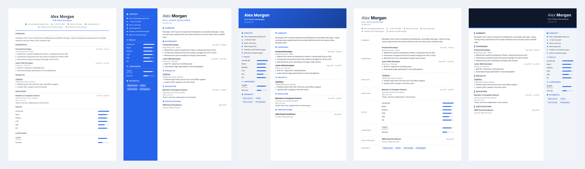
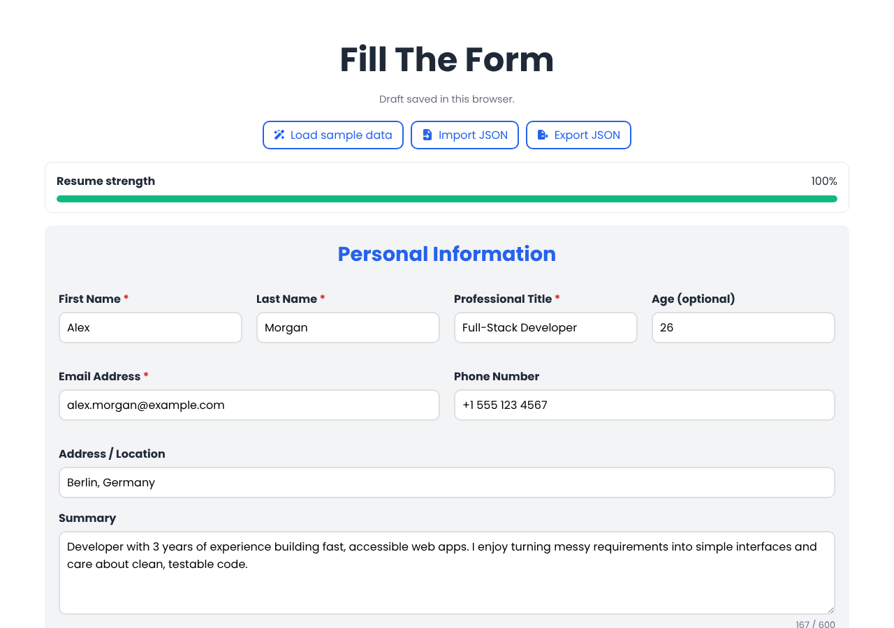
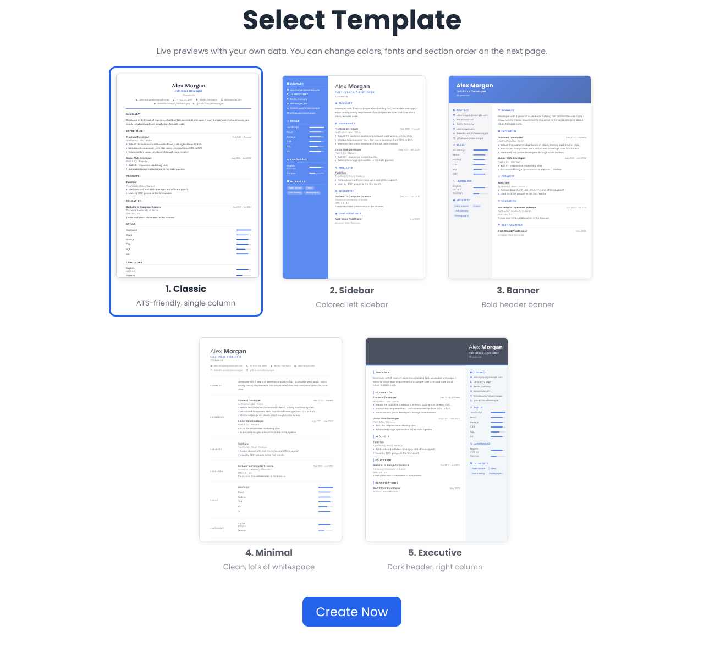
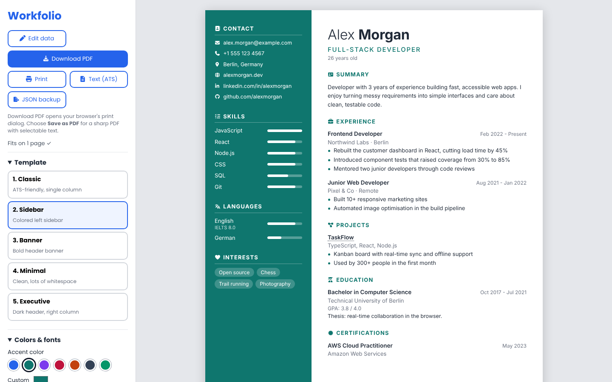

# Workfolio

A free, browser-based resume builder. Follow a guided form, pick one of **five templates**, restyle it live, and export your resume as PDF, editable Word, Excel, or plain text. An on-device **AI Job Match** tool compares your resume with a job posting and tells you what to fix.
Built with **vanilla JavaScript, HTML and CSS** - no app framework, build step, or backend.

> Your resume data stays in your browser and is saved in `localStorage`. The Word and Excel exports are built in the browser without any library; resume content is never uploaded.

## Live Demo

**[Try Workfolio Live →](https://erfankhadiv.github.io/Workfolio/)**

Build, customize, and export your resume directly in your browser — no installation required.


## Screenshots


*The five templates, filled with the built-in sample data.*

| Fill in the form | Pick a template (live previews) |
| --- | --- |
|  |  |


*The viewer: restyle the resume live (template, accent color, font, spacing, paper size, section order) and export it.*

## Features

**Content**
- Personal info, links (LinkedIn, GitHub, portfolio), summary and optional profile photo with an in-browser crop tool
- Repeatable sections: education (GPA, details), experience (achievement bullets), projects, skills, languages (with certificate such as IELTS), certifications and awards
- Interests, with validation and inline error messages
- Guided, step-by-step form with progress, Back / Next controls, example placeholders, and autosave
- Draft that survives reloads (and migrates data saved by older versions)

**AI Job Match** (runs in your browser)

- Paste a job description and get a match score, a requirement-by-requirement breakdown with the resume line that backs each one, and the skills the posting mentions that your resume does not
- Semantic matching with sentence embeddings (`all-MiniLM-L6-v2` through Transformers.js) and cosine similarity, combined with a skill-dictionary keyword check
- Works without the model too: if it cannot be downloaded (or you untick it), it falls back to TF-IDF keyword matching and says so
- Concrete suggestions, plus a **Tailor** button that moves your most relevant bullets and skills to the top. It only reorders, never rewrites, and it can be undone

**Clean page breaks**

- Entries are never cut in half, and sections can split between entries, so pages stay full instead of leaving blank gaps
- In sidebar templates, if the sidebar is only slightly too tall for page 1, its spacing tightens automatically so contact, skills and languages stay on the first page

**Design**
- 5 templates: Classic (ATS-friendly), Sidebar, Banner, Minimal, Executive
- Live template previews that use *your* data
- Accent color picker, font choice, skill style (bars / stars / tags), spacing and paper size (A4 / US Letter)
- Sticky mobile live preview with an expanded full-screen preview while changing design settings
- Show / hide and re-order any section; hide photo or age
- Page-aware layout: entries and headings are never cut by a page break, dashed page guides show where each page ends, and multi-page resumes get "Page 1 of 2" numbers (can be switched off)
- Page counter that tells you when the resume spills onto a second page

**Services**
- Resume-strength score with concrete tips
- Download PDF or print: opens a clean, resume-only print view; choose Chrome’s “Save as PDF” for selectable text
- Plain-text export for application forms and ATS
- Editable Word (`.docx`) export that follows the selected template: header, colored sidebar or banner, real bullet lists, right-aligned dates, shaded skill tags and level dots, clickable links. Template fonts are mapped to Georgia / Calibri so it looks right on any machine
- Excel (`.xlsx`) export with one sheet per section, for tracking applications or reusing the data
- JSON export / import for backups and moving between devices
- One-click sample data to explore the templates

**Quality**
- All user text is inserted with `textContent` (no HTML injection) and links are restricted to `http(s)`
- Responsive, keyboard-accessible, labelled form fields

## Run it locally

No install needed. Serve the folder (recommended, because browsers treat `file://` storage differently):

```bash
npx serve .
# or
python3 -m http.server 8000
```

Then open `http://localhost:8000`.

## Project structure

```
Workfolio/
├── index.html              # landing page + form + template picker
├── resume.html             # resume viewer with the design panel and exports
└── assets/
    ├── css/
    │   ├── style.css       # landing page / form
    │   ├── viewer.css      # design panel layout and print rules
    │   ├── resume.css      # the resume itself: shared base + 5 templates
    │   └── ai.css          # AI Job Match dialog
    ├── js/
    │   ├── core.js         # data model, migration, sample data, score, text export
    │   ├── render.js       # builds the resume DOM from the data
    │   ├── paginate.js     # page-break layout: keeps entries and headings whole across pages
    │   ├── zip.js          # tiny ZIP writer shared by the Office exporters
    │   ├── word-export.js  # .docx exporter (template-aware WordprocessingML)
    │   ├── excel-export.js # .xlsx exporter (one sheet per section)
    │   ├── ai-match.js     # AI Job Match engine: embeddings, keyword analysis, tailoring plan
    │   ├── ai-panel.js     # AI Job Match dialog (UI)
    │   ├── index.js        # form logic, validation, autosave, previews
    │   └── viewer.js       # design panel, PDF / print / export buttons
    └── imgs/               # logo, avatar and README screenshots
```

## How it works

1. `index.js` collects the form into one JSON object (`core.js` normalises and saves it).
2. `resume.html` loads it, `render.js` builds the resume, `paginate.js` lays out the page breaks, and `viewer.js` applies design changes live.
3. A template is just a CSS block (`.tpl-N` in `resume.css`), so adding one needs no extra JavaScript.

### AI Job Match

1. The job description is split into requirement lines. The whole resume is split into chunks: the title and summary, every bullet, every project, job and education entry as a whole, skills, certifications, languages and interests.
2. Each requirement is compared with every chunk using two signals: sentence embeddings (`all-MiniLM-L6-v2`, quantized ONNX, about 25 MB, run by Transformers.js in WebAssembly) and TF-IDF word overlap with a small synonym list (so "thesis" can find a final project). A requirement counts as supported if either signal finds good evidence anywhere in the resume.
3. Skills and exam names that a requirement mentions (about 150 in a built-in dictionary, plus IELTS/TOEFL and similar) are checked against the whole resume, and a few non-skill concepts (papers/manuscripts, research, hands-on projects) are matched by the words a resume uses to show them.
4. Soft skills such as problem-solving or teamwork cannot be proven by keywords, so they are shown as "Soft skill" with advice instead of being called a gap.
5. The overall score blends requirement fit (60% with the model, 50% without) and keyword coverage. Thresholds are hand-tuned heuristics, not a hiring prediction.
6. Tailor reorders bullets and skills by relevance; the previous order is kept so it can be restored.

Privacy: the library (jsDelivr, with unpkg as a fallback) and the model files (Hugging Face, with hf-mirror.com as a fallback) are fetched the first time and cached by the browser. If neither can be reached, the dialog says why and falls back to keyword matching. Your resume and the job text are never sent anywhere. Without network access it uses keyword matching only.

## Tech

JavaScript (ES2020) - HTML5 - CSS3 - [Transformers.js](https://github.com/xenova/transformers.js) (on-device embeddings, loaded on demand) - [Font Awesome Free](https://fontawesome.com) - Google Fonts (Inter, Lora, Poppins)

## Author

**Erfan Khadiv** - [GitHub](https://github.com/ErfanKhadiv) - [LinkedIn](https://www.linkedin.com/in/erfan-khadiv-777a66279/)

## License

[MIT](LICENSE)
